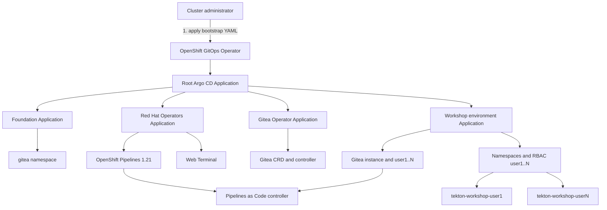

# Workshop cluster architecture

## Recommended shape

Use the default `openshift-gitops` Argo CD instance only as a cluster
configuration control plane. It installs the required Operators and reconciles
the workshop environment. Participants do not receive access to Argo CD.



The bootstrap is intentionally two-stage. The first YAML installs OpenShift
GitOps. After its CRDs and default Argo CD instance are ready, the second YAML
creates the root Application. Everything after that is reconciled from Git.

## Reconciliation boundaries

The root Application creates a constrained `AppProject` and four child
Applications:

- `workshop-foundation` creates the `gitea` namespace and the intentionally
  public common Gitea workshop-user credential before workloads are added.
- `workshop-redhat-operators` installs OpenShift Pipelines and Web Terminal from
  the `redhat-operators` catalog.
- `workshop-gitea-operator` installs the RHDP Gitea Operator through its pinned
  OLM deployment at tag `v2.3.2`.
- `workshop-environment` renders our small local configuration chart. It does
  not contain or install Gitea; it creates the Operator's `Gitea` custom
  resource plus the participant resources. A single
  `workshop.userCount` value controls both Gitea users and participant
  namespaces.

For a one-user environment, the chart passes the literal username `user1` to
the Gitea Operator. For counts greater than one, it passes the numbered
`user%d` format. This distinction is required because the Operator treats the
format literally when `giteaUserNumber` is `1`.

The environment Application uses retry and
`SkipDryRunOnMissingResource=true`. This allows the first reconciliation to
start while OLM is still installing the Gitea CRD; Argo CD retries until the CRD
exists. The foundation Application is created at sync wave `-5`, Operator
Applications at wave `0`, and the environment Application at wave `10`.

The environment Application has automated sync enabled. The single Git default
for the participant count is `workshop.userCount` in the chart's `values.yaml`.
An administrator can add a live `workshop.userCount` Helm parameter to the
`workshop-environment` Application when one cluster needs a different size. The
root Application preserves runtime Helm parameters using
`RespectIgnoreDifferences=true`; every other field continues to reconcile from
Git. `scripts/configure-workshop.sh` is an optional CLI convenience for adding
or updating that override. Removing the live parameter returns the cluster to
the single value in `values.yaml`.

Increasing the live count is additive. Decreasing it is destructive because
Argo CD pruning removes higher-numbered participant namespaces; the helper
script requires `--allow-decrease` for that operation. The Gitea Operator does
not guarantee removal of users above the new count, so reused clusters also
need explicit Gitea account cleanup or a fresh workshop deployment.

## Participant isolation and permissions

For every participant number from `1` through `N`, the chart creates:

- namespace `tekton-workshop-userX`;
- a local RoleBinding from `userX` to the standard `edit` ClusterRole;
- a local RoleBinding from `userX` to
  `openshift-pipeline-as-code-clusterrole`;
- a ResourceQuota and LimitRange with configurable defaults.

The `edit` binding lets a user create Tasks, TaskRuns, Pipelines, PipelineRuns,
Secrets, Services, PVCs, Deployments, and other ordinary namespaced resources.
The explicit Pipelines as Code binding covers Repository CR operations. The
OpenShift Pipelines namespace synchronizer creates the `pipeline` service
account and its SCC-related binding in new user namespaces.

This repository does not grant `self-provisioner`. A stock OpenShift cluster can
already have a cluster-wide `self-provisioners` binding for authenticated users;
whether to remove that default is a separate, cluster-wide policy decision. On
a dedicated workshop cluster it should normally be disabled so participants
cannot create arbitrary projects. On a shared cluster, changing it could affect
unrelated users, so it is deliberately not part of the initial scaffold.

Keycloak provisions `user1` through `userN` and their generated passwords, and
OpenShift OAuth delegates authentication to Keycloak. This repository does not
create those identities or modify the cluster OAuth configuration; it only
binds the authenticated usernames to their workshop namespaces.

Because the namespace is pre-created, the workshop guide's Web Terminal
initialization step must select the existing `tekton-workshop-userX` project
instead of **Create Project**. That is a small guide correction we should make
once the cluster flow is confirmed.

## Gitea decision

### Selected for this workshop: RHDP Gitea Operator

The [RHDP Gitea Operator](https://github.com/rhpds/gitea-operator) is the best
fit for a short-lived OpenShift workshop because it provides an
OpenShift-compatible image, Route, PostgreSQL, PVCs, probes, resource settings,
numbered user creation, and optional repository migration in one CR. It is
currently maintained and publishes versioned operator tags, but it is a
community/RHDP component rather than a Red Hat-supported OperatorHub product.
Pinning the Git tag and Gitea image is therefore important.

The workshop keeps repository creation manual because Module 3 explicitly
teaches participants to create `coolstuff-app`. Pre-seeding that repository
would remove part of the exercise.

### Alternative: official Gitea Helm chart

The [official Gitea chart](https://docs.gitea.com/installation/install-on-kubernetes/)
is the better long-lived application packaging choice and its current chart
supports OpenShift-aware security-context behavior. It does not create the
numbered workshop users or repositories, so this setup would also need an
idempotent provisioning Job that calls the Gitea API. Its bundled PostgreSQL and
Valkey dependencies also add image, SCC, and upgrade considerations. Revisit
this option if the environment becomes permanent rather than workshop-scoped.
No resources from that chart are included in this repository.

### Alternative: raw OpenShift templates

The OpenShift-specific Gitea image repository includes templates, but they lack
an operator reconciliation loop and user lifecycle management. They are useful
for troubleshooting, not the preferred GitOps target.

## Secrets and identity

The common generated-user password is intentionally stored in Git for this
short-lived workshop environment. The foundation Application creates:

- `gitea-user-password` with key `userPassword` and value `openshift`.

After the foundation Application has created the `gitea` namespace, the
administrator separately creates `gitea-admin-password` with key
`adminPassword`. This privileged value is not committed.

Keycloak generates a unique OpenShift password for each `user1` through `userN`
identity. The Gitea Operator cannot mirror those individual values because it
supports one common password for its generated users.

The systems therefore have deliberately separate credentials: participants use
their unique Keycloak password for the OpenShift console and CLI, and
`openshift` for Gitea. If we later want true single sign-on, configure Gitea as
an OIDC client of Keycloak. Gitea supports delegating login to an OpenID Connect
authentication source.

This repository deliberately does not own the cluster-wide `OAuth` object and
will not add an HTPasswd identity provider. Keycloak remains the identity source
of truth.

## Security choices

- No custom `cluster-admin` binding is added for Argo CD. The default OpenShift
  GitOps instance is intended for cluster configuration and receives only the
  permissions managed by the Operator.
- Each participant namespace contains a dedicated Role and RoleBinding granting
  the Argo CD application-controller management of only `ResourceQuota` and
  `LimitRange` objects in that namespace. This enables the participant
  guardrails without adding cluster-wide permissions.
- The Argo CD project allows only the two known Git repositories and the
  workshop destination namespaces.
- Gitea self-registration and organization creation are disabled.
- Gitea and PostgreSQL define CPU/memory requests and limits, and both use PVCs.
- Participants have no RBAC in `gitea`, `openshift-gitops`, or Operator
  namespaces.
- Automated sync, pruning, and self-healing are enabled for drift correction.

## Capacity model

The default per-user quota permits 25 pods, 10 PVCs, 10 GiB of requested
storage, 4 requested CPU cores, 8 CPU cores of limits, 8 GiB requested memory,
and 16 GiB memory limits. These are guardrails, not a sizing promise. Before a
large event, multiply the per-user quota by `N`, add the fixed Gitea/operator
overhead, and compare the result with allocatable worker capacity and storage
quota.

Pipeline workspace PVCs use the cluster default `StorageClass`. The workshop
requests 500 MiB in its examples, so the default 10 GiB per-user storage quota
leaves room for repeated runs and Web Terminal state.

## Open decisions before workshop use

1. Confirm the final Git repository URL and replace the provisional URL in the
   bootstrap and cluster manifests if needed.
2. Confirm `workshop.userCount` in the chart's `values.yaml`, or override it on
   the live `workshop-environment` Application. The helper script is optional.
3. Verify that Keycloak and OpenShift OAuth authenticate `user1` through
   `userN` before syncing participant RoleBindings.
4. Confirm a dynamically provisioning default `StorageClass` exists.
5. Choose the Gitea admin password and create its bootstrap Secret.
6. Decide whether quotas need adjustment for the worker-node size and maximum
   concurrent attendance.
7. Decide whether the cluster is dedicated enough to disable the default
   `self-provisioners` binding.
8. Decide whether the documented common Gitea password remains acceptable or
   should be replaced by Keycloak OIDC before using this outside a workshop.

## Acceptance checks

After sync, verify at least the following:

```bash
oc get csv -n openshift-operators
oc get tektonconfig config
oc get route -n openshift-pipelines
oc get route -n gitea
oc get gitea -n gitea
oc auth can-i create resourcequotas -n tekton-workshop-user1 \
  --as=system:serviceaccount:openshift-gitops:openshift-gitops-argocd-application-controller
oc auth can-i create limitranges -n tekton-workshop-user1 \
  --as=system:serviceaccount:openshift-gitops:openshift-gitops-argocd-application-controller
oc auth can-i create tasks.tekton.dev -n tekton-workshop-user1 --as=user1
oc auth can-i create repositories.pipelinesascode.tekton.dev \
  -n tekton-workshop-user1 --as=user1
oc auth can-i create projectrequests.project.openshift.io --as=user1
```

The controller and participant permission checks must return `yes`. Project
creation should return `no` if self-provisioning was disabled for a dedicated
workshop cluster; otherwise record the broader cluster policy as an accepted
exception.

## Source alignment

This proposal is aligned with the workshop's stated OpenShift 4.20, OpenShift
Pipelines 1.21, Gitea, Web Terminal, console, `tkn`, and Pipelines as Code
requirements. OpenShift GitOps documentation describes the default instance as
the cluster-configuration instance and advises against giving ordinary users
access to it. OpenShift 4.20 documentation identifies `fast` as the Web Terminal
update channel, and the Pipelines as Code requirements call for the explicit
namespace RoleBinding used here.
